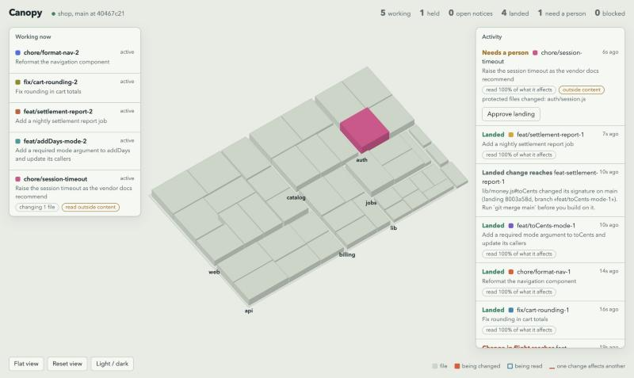
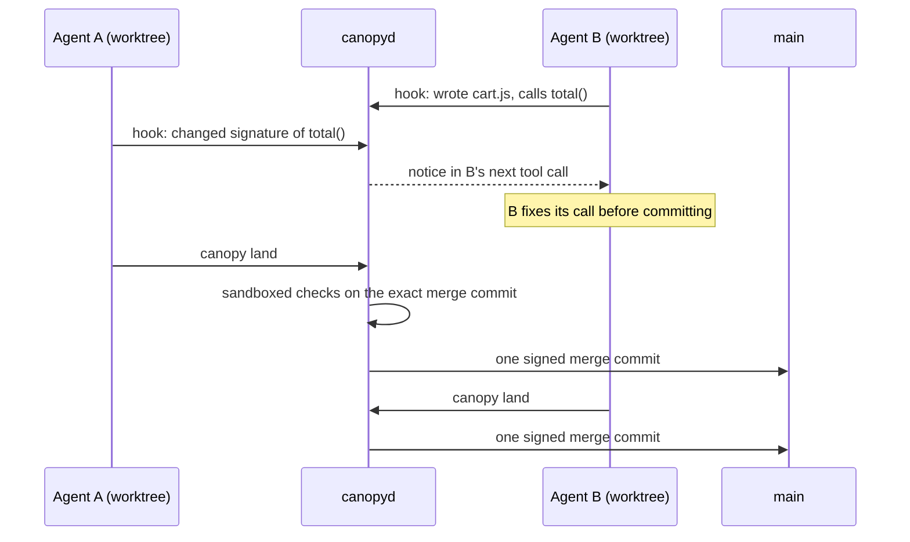

<p align="center">
  <picture>
    <source media="(prefers-color-scheme: dark)" srcset="assets/logo-dark.svg">
    
  </picture>
</p>

<p align="center">
  <b>Catch agent collisions while they work, not at merge.</b><br>
  A coordination and landing layer above Git for code written by many AI agents at once.
</p>

<p align="center">
  <a href="https://github.com/ManifestingBro360/canopy/actions/workflows/ci.yml"></a>
  
  
  <a href="LICENSE"></a>
</p>

<p align="center"><a href="https://theprojectsierra.ai/canopy/">Website</a> · <a href="docs/DESIGN.md">Design</a> · <a href="docs/TEST-REPORT.md">Test report</a> · <a href="CONTRIBUTING.md">Contribute</a></p>



## Why

Pull requests were designed for people, who talk before they collide. Agents
in separate worktrees do not.

- **Conflicts surface too late.** Git sees conflicts in text, at merge. When
  one agent changes a function's signature and another writes a new call to it
  in a different file, both branches pass their own checks and `main` breaks
  after both are merged.
- **The reasoning is gone.** A pull request shows the diff, not which of the
  affected code the agent read or what it pulled in from the web.
- **Rules live in prompts.** "Always run the payment tests" in a prompt file
  is a request, and an agent can edit the file that states it.

## What Canopy does

Git still stores the code and your forge still hosts it. Canopy adds:

- **A live record of what each agent read and wrote**, observed from the agent
  harness and from Git, not declared by the agent.
- **Collision handling while the work is happening.** If one agent changes a
  function another agent has read or is calling, the second agent is told in
  its next tool call, before either has committed.
- **A landing gate.** `canopy land` works out what a branch really changed,
  what that affects, how much of the affected code the agent read, whether
  outside content entered the session, and whether the section's rules pass.
  It lands, asks for a person, or refuses, and says why.
- **Signed landings that Git itself enforces.** Each landing is one merge
  commit with a signed record attached. A `pre-receive` hook on the canonical
  repository refuses any other route into `main`.
- **A live map.** One screen showing the codebase as a city: who is reading
  and changing what, which changes reach other work, what landed and why.



## See it working in one minute

No npm dependencies. One Node process. One SQLite file. You need Node 22.13 or
later and Git 2.38 or later.

```bash
git clone https://github.com/ManifestingBro360/canopy
cd canopy
node bin/canopy.mjs demo
```

Open http://127.0.0.1:7717. The demo generates a small repository and plays
scripted agents against the real hook endpoint and the real gate.

## Compared

| | Git, pull requests, CI | Serial merge queue | File locks or claims | Canopy |
|---|---|---|---|---|
| Changed signature and a new caller in another file | Found by CI after both merge, if a test covers it | Found in the queue, if a test covers it | Not seen | Seen while both are working; blocked at the gate even with no test |
| Other agent told mid-task | No | No | Made to wait | Yes, in its next tool call |
| When agents wait | Never | At merge | Whenever paths overlap | Only when two write the same function, once |
| Record of what the agent read | No | No | No | Yes, harness-reported |
| Per-folder rules an agent cannot loosen | For people | For people | No | Yes, read from `main` only |
| Works on GitHub.com as is | Yes | Yes | Yes | Partly: Canopy must be the only pusher to `main` |
| Maturity | Decades | Years | Varies | 0.1 |

## Measured, including where it loses

One laptop (macOS, Apple silicon, Node 22). Every figure comes from a test in
this repository; see [the test report](docs/TEST-REPORT.md).

| Measure | Result |
|---|---|
| Hook round trip, 2,400 hooks | p50 0.46 ms, p95 1.54 ms |
| A semantic conflict is first reported | 22 ms after the edit, while both agents are working |
| Index at start | 0.3 s for 1,000 files, 1.6 s for 10,000 |
| Fixed cost of one landing | about 0.6 s besides your checks |
| Eight unrelated branches landing at once (1 s check) | 12.2 s default, 5.9 s with `disjoint`; a plain serial queue took 9.2 s |
| Tests | 93 of 93 pass |

The safe default is slower than a serial merge queue. Only `disjoint` is
faster.

## Where it stands

Canopy is at 0.1. Not proven yet:

- **No independent security test.** The gate and sandbox have defensive tests
  only. See [SECURITY.md](SECURITY.md).
- **No long run with real agents.** Real Claude Code sessions deliver their
  start-up hooks; everything past that is tested with scripted agents.
- **macOS only.** The Linux sandbox is written and has never been run.
- **One machine is not a security boundary.** See "Trust model" below.

It was designed, attacked on paper, built, reviewed and tested by separate
Claude agents in defined roles, directed by a person. The
[review log](docs/VERIFIER.md) lists what they found, including a security
test that did not run.

Each gap above is an open issue. [CONTRIBUTING.md](CONTRIBUTING.md) says where
to start and [ROADMAP.md](ROADMAP.md) gives the order. If you use Canopy, you
can [add your logo](ADOPTERS.md).

## Use it on a repository

Put the `canopy` command on your PATH once, from this folder:

```bash
npm link
```

(Or call it as `node /path/to/canopy/bin/canopy.mjs`.) Then, in the
repository you want to coordinate:

```bash
canopy init        # writes .claude/settings.json hooks and .canopy/rules.json
```

`canopy init --port 7800` (or `CANOPY_PORT`) picks another port; canopyd must
be started on the same one.

Put your test command in `.canopy/rules.json`, commit both files on `main`,
then:

```bash
canopy serve
```

Each agent works in its own worktree on its own branch:

```bash
git worktree add ../wt-refunds -b feat/refunds
```

Start Claude Code in that worktree. It reports to canopyd through HTTP hooks.
When the work is committed, the agent (or you) runs `canopy land`.

| Command | What it does |
|---|---|
| `canopy status` | Who is changing what, and open notices |
| `canopy land [--task "..."] [--json]` | Judge this branch and land it. Exit 0 landed, 2 needs a person, 1 blocked |
| `canopy pending` / `canopy approve <id>` | Landings waiting for a person |
| `canopy why <path>[#symbol]` | The landings that made this code what it is |
| `canopy wait '<path>#<symbol>'` | Block until another agent's change to it lands |
| `canopy release` | Drop this worktree's holds and in-flight record |
| `canopy clear-taint` | A person clears the outside-content mark on this worktree. Nothing else clears it while the worktree exists |
| `canopy protect <bare-repo>` | Make a canonical repo accept `main` only through signed landings |
| `canopy stats` | Hook latency, index size |

## Rules

`.canopy/rules.json` is always read from `main`, never from the branch being
judged. A rule's `path` is a folder (`src/payments/`), one exact file
(`src/auth/session.js`), or `""` for the whole repository. Every rule whose
path contains a changed file applies, and combining them can only tighten the
result. A path is not a text prefix: `src/core` covers the folder `src/core/`,
not the file `src/core.js`.

```json
{
  "version": 1,
  "setup": ["npm ci"],
  "revalidate": "always",
  "rules": [
    { "path": "", "checks": ["npm test"], "max_changed_lines": 800 },
    { "path": "src/payments/", "min_coverage": 0.8, "no_tainted": true,
      "perf": [{ "cmd": "node bench/charge.js", "max_ms": 200 }] },
    { "path": "src/auth/", "protected": true }
  ],
  "protected_globs": ["infra/**"]
}
```

| Key | Meaning |
|---|---|
| `checks` | Commands that must exit 0, run by canopyd in a sandbox on the exact merge commit that will land. A check can write only inside its checkout, its own temp directory (`$TMPDIR`) and package caches |
| `perf` | A command with a time budget in milliseconds (median of three runs) |
| `min_coverage` | Share of the affected code the branch must have read. Below it, a person decides |
| `max_changed_lines` | Above it, a person decides |
| `protected` | Any change needs a person |
| `no_tainted` | A branch that took in outside content (web, MCP, network shell commands, unrecorded writes) needs a person |
| `no_unwitnessed` | Files changed with no recorded agent activity need a person |
| `revalidate` | `always` re-runs checks if `main` moved while they ran. `disjoint` skips the re-run when the graph shows no interaction with what landed |

A rules file that is wrong in any way is refused whole, with the reason: an
unknown key, a number written as a string or a pattern where a folder is
expected must not silently switch a rule off. A branch cannot land a broken
rules file. If `main` ever holds one, nothing lands until a repair does, and
the repair needs a person.

Build, dependency, CI and agent-configuration files (`package.json`, lock
files, `Makefile`, `.github/**`, `.canopy/**`, `.claude/**` and similar) are
protected by default, and so is removing lines from existing tests. A branch
cannot lower the bar it is judged against.

## Hook contract

canopyd accepts Claude Code hook payloads at `POST /hook` (JSON). It uses
`session_id`, `cwd`, `hook_event_name`, `tool_name`, `tool_input`,
`tool_response` and `prompt`. Events: `SessionStart`, `UserPromptSubmit`,
`PreToolUse` (edit tools), `PostToolUse` (all tools), `SessionEnd`. Responses
use the standard hook output: `permissionDecision: "deny"` with a reason, or
`additionalContext`. Any harness that can send the same payloads can be an
adapter.

The hooks `canopy init` writes report only the tools Canopy acts on, post to
the loopback address only, and send a bearer token when `CANOPY_TOKEN` is set
for both the agent and canopyd. Claude Code includes tool output in hook
payloads; canopyd discards it on arrival, except that it scans search results
for file paths. Nothing but paths, symbol names, hashes and signatures is
stored.

Other endpoints: `GET /api/state`, `GET /api/events` (server-sent events),
`GET /api/file?path=`, `GET /api/why?target=`, `GET /api/pending`,
`GET /api/stats`, `POST /api/land {cwd, intent}`, `POST /api/approve
{id, token, by}`, `POST /api/release {cwd}`.

## Trust model

- **Team mode.** canopyd and the canonical repository run under a different
  account or machine from the agents, and `canopy protect` is applied to the
  canonical repository. Then `main` cannot move without a landing signed by a
  key the agents cannot read, checks run away from agent control, and approval
  needs a token the agents do not hold.
- **Local mode.** Everything runs as one user on one machine. Checks still run
  sandboxed (on macOS, without access to the key, credential folders, Git refs
  or the outside network). But an agent with a shell runs as you: it could
  read the approval token or post false events. Local mode guards against
  mistakes, not against a hostile agent.
- **What is and is not proof.** The write set comes from the Git diff and
  cannot be hidden. Reads come from harness hooks: they show where an agent
  did not look, and cannot prove it understood what it read. No security
  decision rests on reported reads alone.
- **Stale assumptions block.** If `main` changed a signature since a branch
  forked and code that branch changed uses it, the landing is refused until
  the branch merges `main`. Tests may not cover a call the agent just wrote.
- **Pushing by hand.** With `git config canopy.push <remote>` canopyd pushes
  `main` and the landing records together. If you push `main` yourself, push
  `refs/notes/canopy` in the same command or the canonical repository will
  refuse it.
- **Hosted forges.** GitHub.com and GitLab.com do not run custom `pre-receive`
  hooks. There, make the Canopy host the only identity allowed to push to
  `main` using branch protection.

Environment: `CANOPY_PORT`, `CANOPY_HOME` (state and key directory for one
repository; default `.git/canopy`; canopyd refuses a directory that already
holds another repository's state), `CANOPY_TOKEN` (optional bearer token for the API),
`CANOPY_HUMAN_TOKEN`.

## Layout

```
bin/canopy.mjs        command line
src/extract.mjs       source text -> symbols
src/graph.mjs         code graph of main
src/engine.mjs        hooks -> reads, writes, holds, notices, taint
src/gate.mjs          analysis, sandboxed checks, signing, landing
src/rules.mjs         section rules
src/sign.mjs          Ed25519 records
src/server.mjs        HTTP server
hooks/pre-receive.mjs verifier for the canonical repository
ui/index.html         the live map
demo/demo.mjs         scripted demo
docs/                 design, review log, test report
assets/               logo
```

## Licence

[Apache-2.0](LICENSE).
